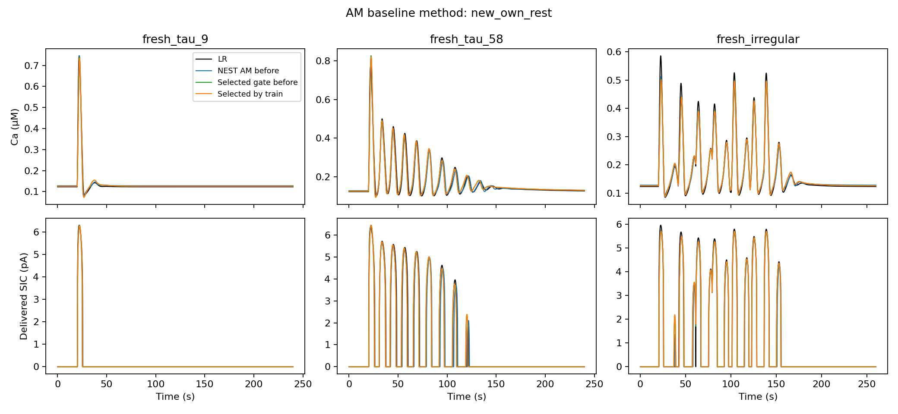
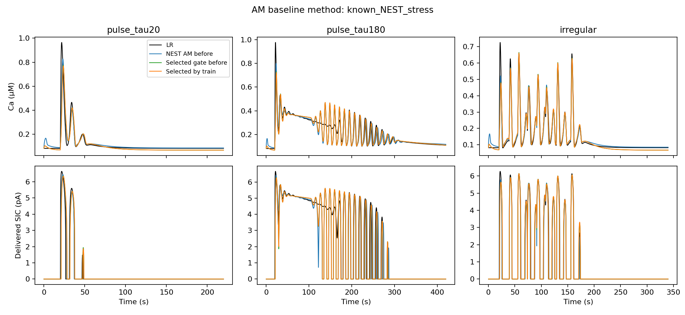

# AM: продолжение базового подбора

Критерий RestObjective сохранён: статические режимы/спектральные якоря,
собственный покой, высоты/ширины/интервалы/число пиков, первая задержка,
слабый поточечный остаток. Новые штрафы по SIC или абсолютным временам
пиков не добавлялись. 21 параметр и 12 областей; пять перезапусков на ветвь,
по 1500 вызовов остатка на каждую из двух LS-стадий и Powell.

| Координата h | До | После, независимый DOP train-loss | Улучшение |
|---|---:|---:|---:|
| cube | 28.151381 | 27.815410 | 1.19% |
| log | 17.742868 | 17.585170 | 0.89% |

По обучению выбран `log`: [selected_AM.json](../../models/am_baseline_refit/selected_AM.json).
Диагностические входы не участвовали в выборе. Исходные модели и прежний
default NEST-кандидат не перезаписаны. Унаследованные старые loss-поля
в JSON исторические; текущие значения находятся в этой таблице и summary.json.

## Результат по выходу SIC

- new_own_rest: средняя RMSE SIC 0.53967 → 0.54092 pA; совпадение числа SIC-пиков 3/5 → 3/5.
- known_NEST_stress: средняя RMSE SIC 0.92126 → 0.92859 pA; совпадение числа SIC-пиков 3/5 → 3/5.

Уменьшение базового train-loss не дало общего улучшения SIC выбранной ветви.
Ветка h³ восстановила правильное число SIC-пиков на: pulse_tau20.
На 2 из пяти новых входов число SIC-пиков не совпадает.
Общая приёмка не пройдена.

## Численное уточнение без изменения критерия

Первые два продолжения на ветвь использовали прежний RK4/.005 и
глобальные bounds Powell. У cube оптимизатор нашёл точку, где
ошибка C порядка 2e-7 μM меняла классификацию слабого пика на пороге
prominence=.02; DOP853 отверг этот результат. Проверка сохранена в
initial_numerical_audit.json. Затем проведены ещё два продолжения
с RK4/.001 и локальным Powell: ±.01*max(1,abs(parameter)) внутри
прежних допустимых bounds. Остаток, пороги обнаружения пиков,
обучающие входы и число параметров не менялись. Все попытки
выбираются только после полного DOP replay обучения.

Затем быстрые автономные attractor-статистики были заменены полными
траекториями того же фиксированного временного окна. Для ускорения
использован кешированный аналитический поток NEST-решателя; остаток
не менялся. Проведено ещё по одному продолжению. На исходных моделях
этот helper воспроизводит независимый train-loss с разницей около 1e-7
(flow_helper_audit.json). Независимый DOP по-прежнему определяет выбор.

## SIC в NEST

Новые входы используют базовую методику: фон I=.3, скачок .35,
собственный покой каждого кандидата и задержка входа 20 с. Набор
заранее зафиксирован в evaluation_plan.json. Известный стресс-набор
повторяет прежний benchmark: фон .2, скачок .7, общее начальное
состояние LR. Он не был добавлен в обучение.

| Набор | Вход | SIC RMSE: прежний cube | SIC RMSE: выбранная координата до | SIC RMSE: после | Пики SIC LR/до/после |
|---|---|---:|---:|---:|---:|
| new_own_rest | fresh_tau_9 | 0.1668 | 0.1406 | 0.1390 | 1/1/1 |
| new_own_rest | fresh_tau_29 | 0.4027 | 0.2120 | 0.2048 | 4/4/4 |
| new_own_rest | fresh_tau_58 | 0.5643 | 0.5561 | 0.5604 | 9/9/9 |
| new_own_rest | fresh_tau_115 | 1.1465 | 1.4822 | 1.4825 | 17/18/18 |
| new_own_rest | fresh_irregular | 0.4167 | 0.3075 | 0.3179 | 12/13/13 |
| known_NEST_stress | pulse_tau20 | 0.4241 | 0.5905 | 0.6142 | 3/3/3 |
| known_NEST_stress | pulse_tau100 | 1.9376 | 1.9482 | 1.9504 | 13/12/12 |
| known_NEST_stress | pulse_tau180 | 1.3691 | 1.0681 | 1.0731 | 18/19/19 |
| known_NEST_stress | periodic | 0.5071 | 0.5069 | 0.5128 | 9/9/9 |
| known_NEST_stress | irregular | 0.5364 | 0.4926 | 0.4926 | 14/14/14 |





Проверка выбранной реализации против собственного DOP853: max ошибка C=1.89e-10 μM, h=3.95e-11.
Скорость заново не измерялась. Уменьшение train-loss не означает
автоматического прохождения всех SIC-протоколов или полной приёмки.

## Воспроизведение

```bash
export PYTHONPATH=src:scripts OPENBLAS_NUM_THREADS=1 OMP_NUM_THREADS=1
export MPLCONFIGDIR=/tmp/nest-matplotlib XDG_CACHE_HOME=/tmp
.venv/bin/python scripts/refine_server_candidates.py --base-objective \
  --models AM_sqrt_tails__cube --output results/am_baseline_refit/cube \
  --budget 1500 --restarts 2 --seed 20261024
# Аналогично для AM_sqrt_tails__log с отдельным output.
# Дополнительные продолжения описаны в docs/am_baseline_refit.md.
.venv/bin/python scripts/evaluate_am_baseline_refit.py
```

Для нового запуска укажите новый каталог output; существующие
результаты скрипт не перезаписывает.
Полные попытки, checkpoints и независимые replay-метрики сохранены
в cube/ и log/. Сырые NEST-траектории — в nest/.
