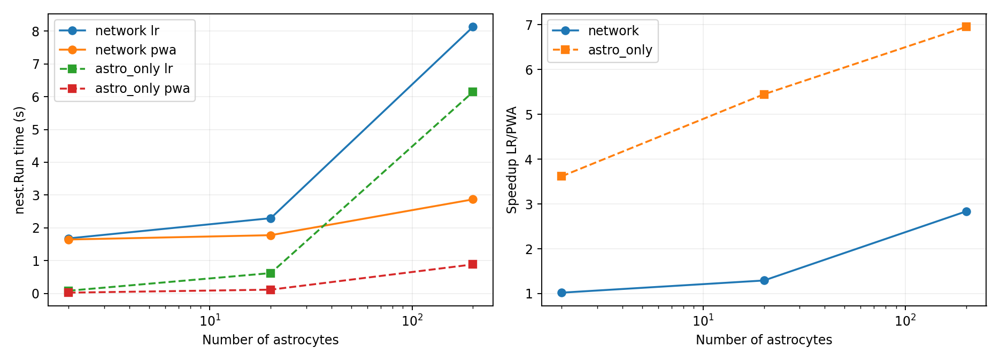

# Масштабирование числа астроцитов

Нагрузочный тест AM с фиксированными 20 AEIF-нейронами. Это заданный спайковый вход → астроциты → нейроны, без обратной связи. Используется полная AM с дополнительным IP3-порогом 1.3.

Каждый астроцит получает свой заранее заданный нерегулярный поток около 20 Гц (период 50 мс с независимым джиттером ±20 мс), скачок IP3=0.2 мкМ, tau=7.142 с. Для LR/PWA входы совпадают; при росте популяции сохраняются входы ранее добавленных клеток. Потоки разных клеток различаются. Сумма весов SIC на каждом нейроне равна 10 во всех отношениях. Нормировка сохраняет усиление, но увеличение числа независимых источников меняет усреднение сигнала; поведение разных размеров не обязано совпадать.

60 с моделируемого времени, шаг NEST 1 мс, один поток. Время — nest.Run без регистраторов: отдельный прогрев для каждой конфигурации, семь повторов с перемешанным порядком. Построение, Prepare, Cleanup и считывание сохранены отдельно.

| Конфигурация | Астроцитов | Нейронов | LR, с | PWA, с | Ускорение | 95% интервал |
|---|---:|---:|---:|---:|---:|---:|
| Только нейроны | 0 | 20 | 1.321 | — | — | — |
| network | 2 | 20 | 1.678 | 1.644 | 1.02× | 0.97–1.10 |
| astro_only | 2 | 0 | 0.080 | 0.022 | 3.62× | 2.97–4.01 |
| network | 20 | 20 | 2.294 | 1.776 | 1.29× | 1.27–1.34 |
| astro_only | 20 | 0 | 0.619 | 0.114 | 5.45× | 5.11–6.30 |
| network | 200 | 20 | 8.131 | 2.868 | 2.83× | 2.72–3.07 |
| astro_only | 200 | 0 | 6.145 | 0.884 | 6.95× | 6.29–7.36 |

## Точность и нейронный эффект

| Астроцитов/нейрон | RMSE Ca, мкМ | RMSE SIC, пА | Частота LR/PWA, Гц | Прирост спайков LR/PWA к контролю без астроцитов |
|---|---:|---:|---:|---:|
| 0.1 | 0.1248 | 3.452 | 19.141/19.065 | 5334/5243 |
| 1 | 0.1249 | 3.475 | 19.141/19.065 | 5334/5243 |
| 10 | 0.1250 | 3.485 | 19.141/19.065 | 5334/5243 |

Интервалы получены парным bootstrap по семи повторам и описывают только разброс времени на этой машине. Динамика астроцитов с нейронами и без них совпала побитово для каждого размера и обеих моделей. В JSON сохранена также аддитивная оценка по закону Амдала: (T_нейронов + T_астро_LR)/(T_нейронов + T_астро_PWA). Это оценка по отдельным запускам, а не профилирование сети.

Тест без нейронов измеряет астроцитарную популяцию вместе с доставкой спайков и инфраструктурой NEST, не чистое время C++-ядра. Простая сумма времени изолированных компонентов может отличаться от сети из-за передачи SIC и планирования событий. Число SIC-соединений также меняется и сохранено в плане.

Это одна нагрузочная конфигурация при одном шаге интегрирования; точность двух моделей не равна. Выигрыш нельзя переносить на произвольные сети или выдавать за сравнение при равной ошибке.

[Полные результаты и сырые повторы](evaluation.json) · [Метрики](metrics.csv) · [Времена стадий](timings.csv). Полные траектории — `traces/*.npz`, входы — `inputs.npz`. В JSON также сохранены физические диапазоны, CV ISI, корреляции, ошибки частот и интеграл SIC.

Воспроизведение: `.venv/bin/python scripts/benchmark_astro_ratio.py --output results/astro_ratio_repeat`. Только отчёт: `--report-only --output results/astro_ratio`.
