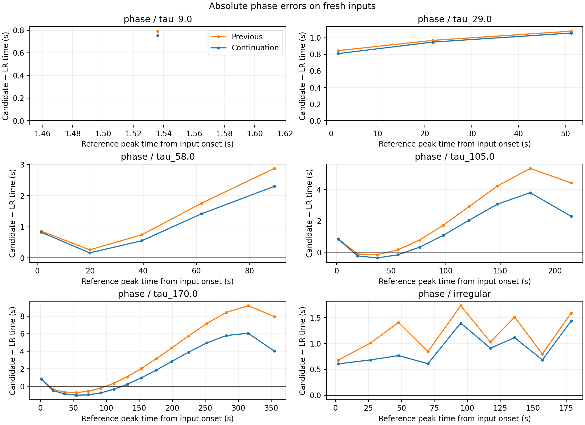
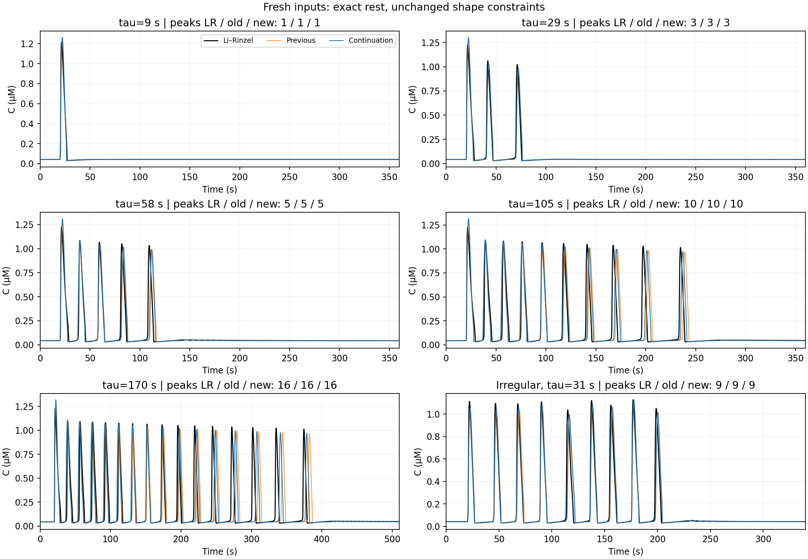
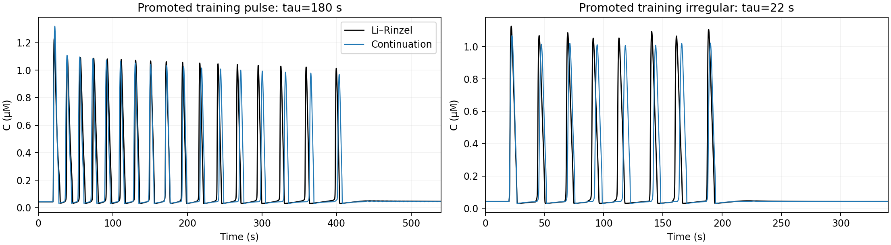

# FM: продолжение с усиленным критерием времени пиков

Исходник — сохранённый кандидат
`models/continued_shape_candidates/FM_control.json` из `fm_shift_continuation`.
Он и все прежние результаты остаются неизменными.

## Постановка

Та же непрерывная PWA с 8 областями: 20 свободных коэффициентов и 7
упорядоченных порогов. Система начинается в точном устойчивом покое
Ли–Ринцеля; вход включается на 20-й секунде. Начальное состояние и фазовый
сдвиг траекторий не подбираются. Ни обрезания кальция, ни дополнительных
областей или нелинейных членов не добавлено. Региональные матрицы постоянны,
I затухает по экспоненте; аналитическая региональная динамика сохранена.

Усилен только мягкий критерий абсолютных времён пиков: его остаток умножен
на 3, то есть соответствующая часть суммы квадратов — на 9. Остальные
составляющие и все жёсткие ограничения сохранены. Поэтому значение общей
функции нельзя непосредственно сравнивать с числами прошлых раундов.
В этом раунде исходник и кандидаты оцениваются одним и тем же новым критерием.

Из прошлой контрольной выборки явно перенесены в обучение длинный вход
`tau=180` и нерегулярный `tau=22`, seed=20261030. Теперь 10 обучающих
протоколов. Все ранее просмотренные тесты записаны как известные;
перенесённые протоколы больше не являются независимой проверкой.

Ограничения: точный устойчивый покой; физические границы; все восемь
стационарных режимов, амплитуды/ширины циклов в пределах 10%, периоды в
пределах 20%; верное число динамических пиков, высота/ширина каждого в
пределах 10%. Определение пика прежнее: prominence=0.02 мкМ.
Абсолютные времена пиков сравниваются в хронологическом порядке без
переноса траекторий; совмещение применяется только к отдельному критерию формы.

Четыре запуска с seed=20261030..20261033 от одного кандидата. DE — 35
поколений, популяция 32, четыре параметра; два старта наименьших квадратов
и Powell по всем 27 параметрам, по 1600 вызовов остатка на локальный этап.
Вызовы якобиана входят в бюджет. Фактические вызовы/время и все проверки
сохранены в `trials/*`. Стартовые возмущения и результаты DE могут приводить
к одному бассейну; четыре запуска не доказывают глобальную оптимальность.

Отбор: независимый DOP853, выполнение всех обучающих ограничений, затем
минимальная обучающая ошибка. Исходник также участвует в сравнении: если
допустимого улучшения нет, рекомендация остаётся за ним. Рекомендация
записывается до расчёта контрольных откликов в
`recommendation_before_heldout.json`.

Новые входы: tau=9,29,58,105,170 и нерегулярный tau=31,
seed=20261101; все с задержкой 20 с. Длина записи для tau=170 — 510 с,
для остальных импульсов — 360 с, для нерегулярного входа — 340 с.
Контрольные траектории не входят в подбор или инициализацию поля.

Отдельная проверка после подбора: траектории с dt=0.05 с,
rtol=2e-11, atol=2e-13, max_step=0.05 с; ошибки высоты/ширины и абсолютных
времён пиков. Средняя фазовая ошибка считается по всем пикам всех
соответствующих протоколов; при любом несовпадении числа пиков агрегат
не вычисляется. Средний C RMSE — среднее по протоколам, без сдвига сигналов.

## Воспроизведение

Из корня репозитория, с установленными зависимостями и собранным native:

```bash
PYTHONPATH=src:scripts OPENBLAS_NUM_THREADS=1 OMP_NUM_THREADS=1 MKL_NUM_THREADS=1 \
  .venv/bin/python scripts/continue_anchored_fit.py \
  --output /tmp/fm-phase \
  --seed-model models/continued_shape_candidates/FM_control.json \
  --reference-cache results/fm_shift_continuation/cache/FM \
  --promote continuation_heldout_tau_180.0 continuation_heldout_irregular \
  --new-protocols phase --timing-weight 3 \
  --budget 1600 --global-iterations 35 --restarts 4 --workers 4
PYTHONPATH=src:scripts OPENBLAS_NUM_THREADS=1 OMP_NUM_THREADS=1 MKL_NUM_THREADS=1 \
  .venv/bin/python scripts/report_anchored_continuation.py \
  --output /tmp/fm-phase --export-model /tmp/FM_phase_candidate.json \
  --training-plots continuation_heldout_tau_180.0 continuation_heldout_irregular
```

Нужен новый выходной каталог. `config.json` и `source_snapshot_manifest.json`
содержат хеши. `source_snapshot` хранит численный код фактического запуска;
корневой скрипт впоследствии получил поправку только к диагностическим
метаданным при отсутствии улучшения. Математика подбора от неё не меняется.
Решатель полного событийного движения, ускорение и реализация NEST в этом
эксперименте не проверялись.

## Результат

Все четыре запуска допустимы на обучении. Выбран `control_0`: общая
обучающая функция **12405.602 → 6644.594**
по одному и тому же усиленному критерию. Отбор заморожен до новых откликов.
На подробной сетке все 10 обучающих протоколов проходят форму и число пиков;
максимальные ошибки высоты **7.75%**,
ширины **8.80%**.
Точный устойчивый покой и все восемь стационарных проверок сохранены.
Средняя абсолютная ошибка времён 75 обучающих пиков:
**2.632 → 1.827 с**.

На шести новых входах (44 пика):

- Средняя абсолютная ошибка времени пиков **2.141 → 1.522 с**,
  улучшение **28.9%**. Сигналы не сдвигались.
- Средний по протоколам C RMSE **0.13767 → 0.11807 мкМ**,
  улучшение **14.2%**.
- Число пиков совпадает на **6/6**, физические границы соблюдены.
- Высота и ширина вместе проходят на **5/6** у обоих кандидатов.
  У нового нерегулярного входа ошибка ширины одного пика
  **19.99%**
  (прежде **19.76%**),
  что превышает неизменный предел 10%. Этот дефект не исправлялся после
  чтения новых тестов. Кандидат не считается полностью принятым.

С улучшением фазы немного выросла ошибка высоты на длинных импульсах:
при tau=170 с 4.84% до 7.43%, оставаясь в пределах 10%. Фаза также
не стала точной: максимальная абсолютная ошибка времени среди новых
пиков **6.04 с**;
последний пик при tau=170 задерживается на 4.03 с вместо прежних 7.96 с.

| Новый вход | C RMSE, старый → новый, мкМ | Задержка последнего пика, с | Пики LR / новый | Форма ≤10% |
|---|---:|---:|---:|---|
| tau_9.0 | 0.01828 → 0.01827 | 0.79 → 0.75 | 1 / 1 | да |
| tau_29.0 | 0.04850 → 0.04754 | 1.08 → 1.06 | 3 / 3 | да |
| tau_58.0 | 0.11388 → 0.09586 | 2.87 → 2.30 | 5 / 5 | да |
| tau_105.0 | 0.23798 → 0.19324 | 4.41 → 2.29 | 10 / 10 | да |
| tau_170.0 | 0.28804 → 0.26666 | 7.96 → 4.03 | 16 / 16 | да |
| irregular | 0.11933 → 0.08685 | 1.59 → 1.43 | 9 / 9 | нет |







Экспорт: [FM_control.json](../../models/phase_shape_candidates/FM_control.json),
`accepted=false`, с актуальными проверками и хешем в `export_manifest.json`.
Предыдущий кандидат сохранён отдельно. Исходные траектории, все запуски,
CSV, PNG/PDF и точный численный код сохранены рядом.

80 тестов кода прошли. Новая регрессия проверяет, что усиление времени пиков
изменяет только соответствующую часть остатка, сохраняя прочие критерии
и результат проверок допустимости.
