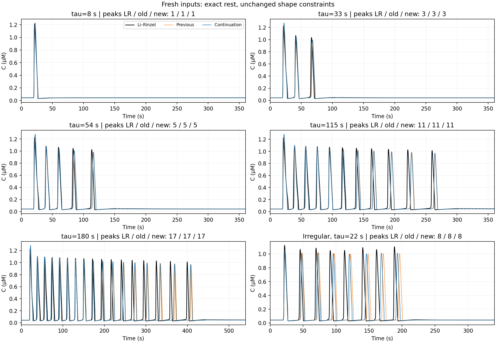
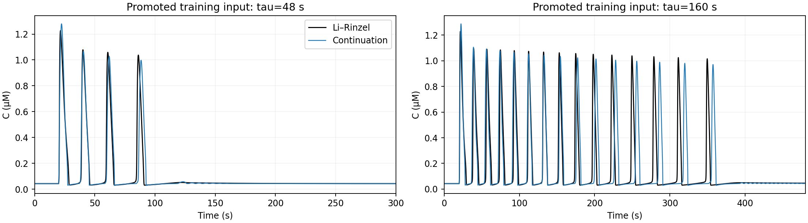

# Линейные сдвиги и продолжение FM-подбора

Продолжение `results/fm_anchored_shapes/`. Предыдущий рекомендованный кандидат
`models/anchored_shape_candidates/FM_control.json` остаётся неизменным.

## Что проверено со сдвигами

В исходной модели уже используются `U=(C-C_ref)/sC` и
`V=(h-h_ref)/(h_ref*(1-h_ref))`. Проверена сетка 4×3 значений начала координат,
включая точный покой Ли–Ринцеля. При согласованном переносе матриц, порогов и
обратного преобразования это одна и та же физическая модель.

`affine_shift_audit.json`: 1000 физических точек на каждый перенос, все восемь
региональных матричных экспонент. Максимальное отличие физического поля
`2.96e-14`, сопряжённых региональных экспонент `1.51e-14`.
`rest_centered_equivalent.json` — эквивалентная запись старого кандидата с
нулевыми координатами покоя. Это не новый результат оптимизации.

Поэтому дополнительные параметры начала координат не вводились: подбирались
те же 20 свободных коэффициентов и 7 упорядоченных порогов, всего 27 параметров
в 8 областях. В каждой области сохраняется постоянная матрица; при
экспоненциальном I движение задаётся матричной экспонентой. Полный событийный
решатель и ускорение здесь не измерялись.

## Условия эксперимента

Из прошлой проверки явно перенесены в обучение `tau=48` (лишний пик) и
`tau=160` (накопление ошибки фазы). Они больше не являются независимой
проверкой. Вместе с шестью прежними входами получается восемь обучающих
протоколов. Начальные условия — точный устойчивый покой Ли–Ринцеля, вход
начинается на 20-й секунде; начальные условия не подбирались.

Ограничения прежние: все восемь стационарных режимов и их морфология;
совпадение числа динамических пиков; ошибка высоты и ширины каждого пика
не больше 10%; точный устойчивый покой и физические границы. Фаза входит
в абсолютные времена пиков. Совмещение пиков используется лишь в отдельном
критерии формы.

Три запуска от последнего кандидата: общий исходник, малые возмущения,
локальный глобальный поиск четырёх параметров, затем два старта наименьших
квадратов и Powell по всем 27 параметрам. Бюджет каждого локального этапа
1200 вызовов остатка; DE — 25 поколений, популяция 32. Фактические вызовы и
время записаны в `trials/*/result.json`. Повторные старты не гарантируют
глобального минимума.

Кандидаты независимо перепроверяются DOP853. Рекомендация замораживается в
`recommendation_before_heldout.json` до расчёта отклика кандидатов на новые
входы. Новые контрольные времена: 8, 33, 54, 115, 180 секунд и нерегулярная
последовательность с tau=22, seed=20261030. Для tau=180 запись длится 540 с.
Контрольные траектории не используются ни в остатке, ни в инициализации поля.

## Воспроизведение

Из корня репозитория после обычной установки окружения:

```bash
PYTHONPATH=src:scripts OPENBLAS_NUM_THREADS=1 OMP_NUM_THREADS=1 MKL_NUM_THREADS=1 \
  .venv/bin/python scripts/continue_anchored_fit.py --output /tmp/fm-continuation
PYTHONPATH=src:scripts OPENBLAS_NUM_THREADS=1 \
  .venv/bin/python scripts/audit_affine_shifts.py --output /tmp/fm-continuation
```

Используйте новый выходной каталог. `config.json` содержит бюджеты и хеши
исходников; полный снимок исходников и манифест также сохранены.

## Результат

Выбран `control_0`: независимо проверенная обучающая ошибка
**4704.055 → 2537.046** на одинаковом
расширенном наборе. Два запуска прошли ограничения; третий сохранил лишний
пик при tau=48 и исключён. Число пиков при tau=48 исправлено с 5 на 4.

На подробной временной сетке dt=0.05 с все восемь обучающих входов проходят;
максимальная ошибка высоты **5.41%**,
ширины **8.72%**.
Точный устойчивый покой и все восемь стационарных проверок сохранены.

На шести новых входах оба кандидата проходят число и форму пиков: **6/6**.
Среднее по протоколам C RMSE **0.17998 → 0.17813 мкМ**
(улучшение 1.03%). Это небольшой общий выигрыш;
при tau=33 и tau=54 ошибка выросла. У нерегулярного входа задержка последнего
пика уменьшилась с 7.78 до 4.46 с; при tau=180 — с 9.35 до 8.24 с.
Заметная ошибка фазы остаётся. В хвосте обучающих tau=48/160 также видны
малые затухающие колебания: проверка числа полных пиков использует прежний
фиксированный prominence=0.02 мкМ. Критерий не менялся при подборе.

| Новый вход | Прежний C RMSE, мкМ | Новый C RMSE, мкМ | Пики LR / новый |
|---|---:|---:|---:|
| tau_8.0 | 0.01995 | 0.01790 | 1 / 1 |
| tau_33.0 | 0.05245 | 0.06736 | 3 / 3 |
| tau_54.0 | 0.10774 | 0.11602 | 5 / 5 |
| tau_115.0 | 0.26425 | 0.25845 | 11 / 11 |
| tau_180.0 | 0.29630 | 0.29252 | 17 / 17 |
| irregular | 0.33917 | 0.31654 | 8 / 8 |





Экспорт: [FM_control.json](../../models/continued_shape_candidates/FM_control.json).
Предыдущая модель сохранена отдельно. Экспорт помечен `accepted=false`: это
обучающе допустимый кандидат, а не утверждение о глобальном соответствии
Ли–Ринцелю. Выбор сделан до чтения новых контрольных откликов.

Проверки кода: 79 тестов; отдельно проверены три случая корректности
аффинного переноса и его области определения.
