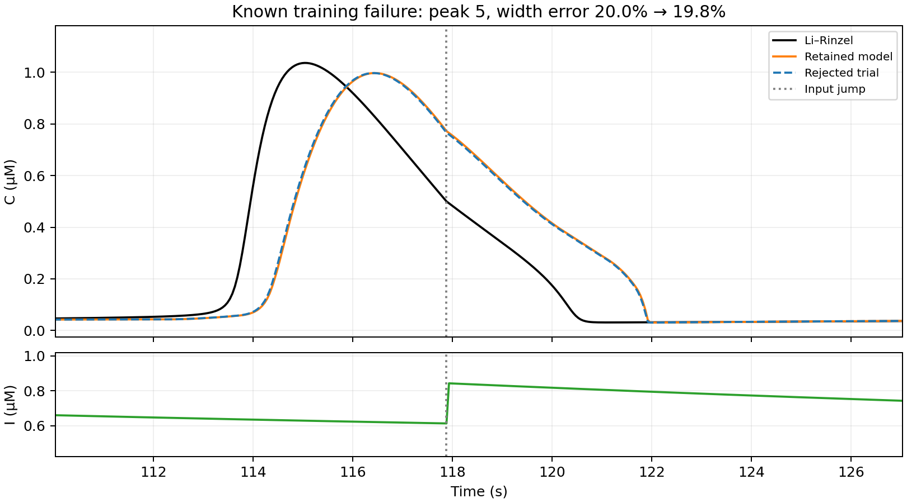
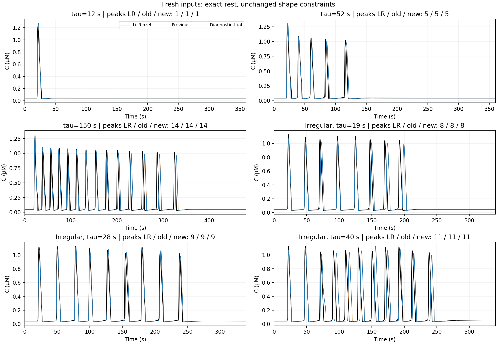
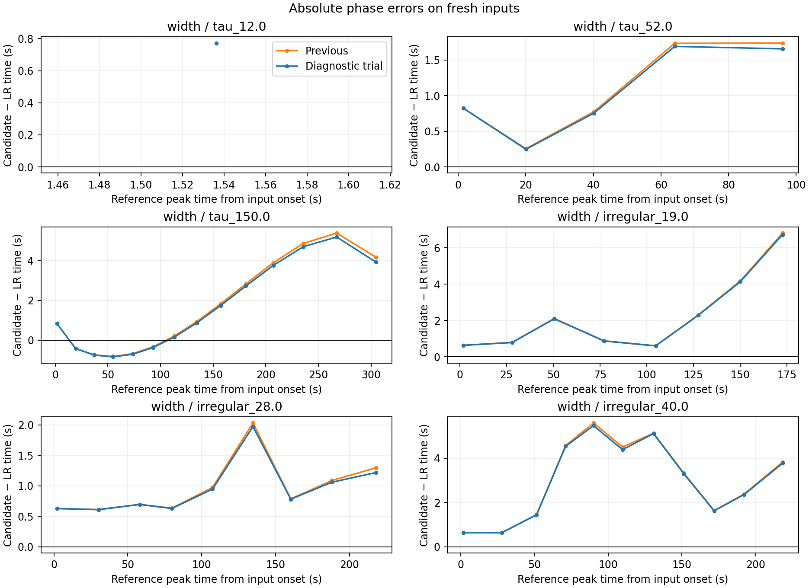
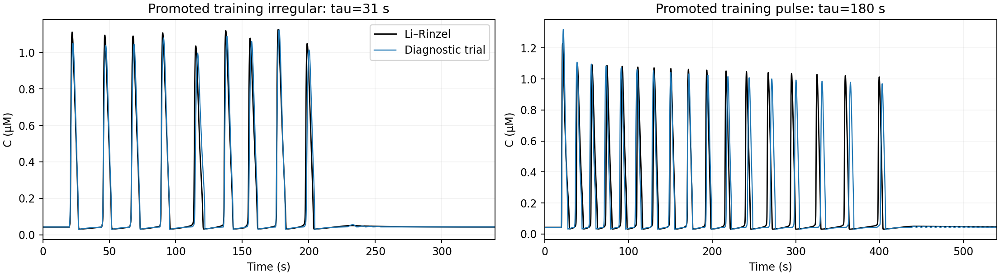

# FM: широкий пик при нерегулярном входе

Продолжение `fm_phase_continuation` от неизменённой модели
`models/phase_shape_candidates/FM_control.json`.

## Цель и условия

На прошлой контрольной выборке у нерегулярного входа tau=31 один пик имел
ошибку ширины около 20%. Этот протокол (`phase_heldout_irregular`,
seed=20261101) явно перенесён в обучение. Теперь 11 обучающих входов;
этот случай больше не является независимой проверкой. Все прежние
контрольные выборки отмечены как известные в `cache/FM/data.json`.

У проблемного пятого пика Ли–Ринцель даёт максимум приблизительно
на 115.03 с; модель запаздывает примерно на 1.4 с. Следующий скачок
входа на 117.881 с попадает на разные части спада пика. Ширина LR
3.755 с, у стартового кандидата 4.505 с. Это чувствительный к фазе
случай, а не равномерно завышенная ширина всех пиков.

Класс модели прежний: 8 областей, 27 свободных параметров, постоянные
региональные матрицы, экспоненциальный I. Нелинейных членов и новых
областей не добавлено. Точный устойчивый покой LR, задержка входа 20 с,
физические границы, восемь стационарных режимов/форм циклов и прежние
динамические ограничения сохранены. Число пиков должно совпадать;
высота и ширина каждого пика должны отличаться не больше чем на 10%.
Prominence=0.02 мкМ; периоды стационарных циклов — допуск 20%.
Ни начальные условия, ни сдвиг траекторий не подбираются.

Дополнительно зафиксирована средняя абсолютная ошибка времени всех
84 обучающих пиков не выше **1.75 с**. У стартового кандидата она
**1.729 с** на подробной сетке. Это сохраняет почти весь прежний выигрыш
по времени пиков; ограничение не применяется к ещё не просмотренным
контрольным откликам. Мягкий вес абсолютных времён остаётся 3, как
в предыдущем раунде. За превышение временного потолка добавлен штраф;
при отборе потолок также проверяется как жёсткое ограничение.
При несовпадении числа пиков фазовый критерий не считается выполненным.

Четыре запуска, seed=20261102..20261105. Все локально уточняют 27 параметров;
различается четырёхмерный глобальный поиск:

| Запуск | Глобальные направления |
|---|---|
| control_0 | log(qb), cI, log(B), log(-D) |
| control_1 | log(qb), cI, первые два параметра упорядоченных зазоров порогов |
| control_2 | log(-mu_0), параметр k_0, log(B), log(-D) |
| control_3 | log(qb), cI, log(B), log(-D), другой seed |

DE: 30 поколений, популяция 32. Затем два старта least-squares и Powell;
по 1600 вызовов остатка на локальный этап, включая вызовы якобиана.
Четыре старта не доказывают глобальную оптимальность.

Отбор по обучению: независимый DOP853, все ограничения, затем минимальная
сумма квадратов. Рекомендация замораживается до новых откликов в
`recommendation_before_heldout.json`. Если допустимого улучшения нет,
стартовый кандидат сохраняется, лучший новый записывается как диагностика.
Дополнительная проверка с dt=0.05 с повторяет форму и временной потолок;
провал этой проверки запрещает экспорт в качестве нового кандидата.

Новая контрольная выборка: три импульса с tau=12,52,150 и три нерегулярные
последовательности с tau=19,28,40, seed=20261102..20261104. Это новые времена
и новые последовательности скачков. Они не входят в подбор и инициализацию
поля. Импульс tau=150 записан 480 с, остальные 360 с; нерегулярные — 340 с.

## Воспроизведение

Из корня репозитория после установки окружения и сборки native:

```bash
PYTHONPATH=src:scripts OPENBLAS_NUM_THREADS=1 OMP_NUM_THREADS=1 MKL_NUM_THREADS=1 \
  .venv/bin/python scripts/continue_anchored_fit.py \
  --output /tmp/fm-width \
  --seed-model models/phase_shape_candidates/FM_control.json \
  --reference-cache results/fm_phase_continuation/cache/FM \
  --promote phase_heldout_irregular --new-protocols irregular \
  --timing-weight 3 --phase-ceiling 1.75 --search-seed 20261102 \
  --diverse-directions --budget 1600 --global-iterations 30 --restarts 4 --workers 4
PYTHONPATH=src:scripts OPENBLAS_NUM_THREADS=1 OMP_NUM_THREADS=1 MKL_NUM_THREADS=1 \
  .venv/bin/python scripts/report_anchored_continuation.py \
  --output /tmp/fm-width --export-model /tmp/FM_width_candidate.json \
  --training-plots phase_heldout_irregular continuation_heldout_tau_180.0
```

Нужен новый выходной каталог. Все проверки и фактические бюджеты — в
`trials/*`, исходники и хеши — в `source_snapshot*` и `config.json`.
Аналитическая региональная динамика сохранена; полный событийный решатель,
ускорение и реализация NEST в этом раунде не проверялись.

## Итог: новый кандидат отклонён

**Сохраняется прежняя модель**
[FM_control.json](../../models/phase_shape_candidates/FM_control.json).
Ни один из четырёх запусков не выполнил все ограничения расширенного
обучения. Вызовов остатка при подборе: **8841**;
дополнительно проверена широкая сетка из **169** пар входных параметров.
Это результат конкретного поиска, а не доказательство отсутствия решения
во всём классе моделей.

| Запуск | Вызовы подбора | Проверенная функция | Макс. ошибка ширины | Ошибка времени, с | Допустим |
|---|---:|---:|---:|---:|---|
| control_0 | 2049 | 20546.19 | 19.76% | 1.688 | нет |
| control_1 | 2259 | 20750.59 | 19.70% | 1.710 | нет |
| control_2 | 2426 | 20538.08 | 19.75% | 1.687 | нет |
| control_3 | 2107 | 20546.19 | 19.76% | 1.688 | нет |

Лучший по функции диагностический вариант — `control_2`. Проверенная
функция снизилась **21309.02 → 20538.08**,
но число пройденных проверок формы осталось **10/11**. На подробной сетке
ошибка ширины проблемного пика **19.84%**
при требуемых ≤10%. Максимальная ошибка высоты —
**7.74%**.
Средняя ошибка времени 84 обучающих пиков **1.729 → 1.684 с**,
потолок 1.75 с выполнен; все числа пиков, точный покой и стационарные
проверки сохранены. Дефект ширины остаётся единственным провалом этого
диагностического варианта. Его не рекомендуем вместо исходника.

В широкой сетке cI менялся от исходного−0.4 до исходного+0.8, log(qb) —
на ±0.15, по 13 значений. Ни одна из 169 пар не прошла динамические
ограничения. Например, при delta_cI=0.7 и delta_log_qb=0.05 ошибка
ширины оказалась 8.90%, но ошибка высоты выросла до 39.82%: это также
отклонённый вариант. Пять лучших по динамическому ранжированию точек
дополнительно проверены полной функцией. Все данные — в `embedding_scan.json`.



На шести новых контрольных входах у обоих вариантов число и форма пиков
прошли **6/6**; средний C RMSE **0.16339 → 0.16117 мкМ**.
Ошибка времени новых 48 пиков **1.973 → 1.933 с**.
Эти небольшие улучшения не отменяют провал известного обучающего случая.
Контрольные отклики не использовались для продолжения подбора.







Нового файла в `models/` не создано. Пробы доступны в `trials/` и
`embedding_scan/` как диагностика; у них `accepted=false`,
`recommended_by_training_only=false`. Удалены унаследованные положительные
флаги и старые проверки исходника. Матрицы, координаты и пороги при этой
правке метаданных не менялись: хеши и подтверждение — в
`diagnostic_metadata_cleanup.json`. После запуска в корневом fitter
также исправлено наследование этих флагов для будущих экспериментов.
Снимок численного кода фактического подбора сохранён отдельно; хеши
соответствуют `config.json`.

**81 тест прошёл**, включая проверку нового временного потолка, отказ
при незавершённых траекториях и запрет наследования положительной
рекомендации исходника в новой непроверенной пробе.
