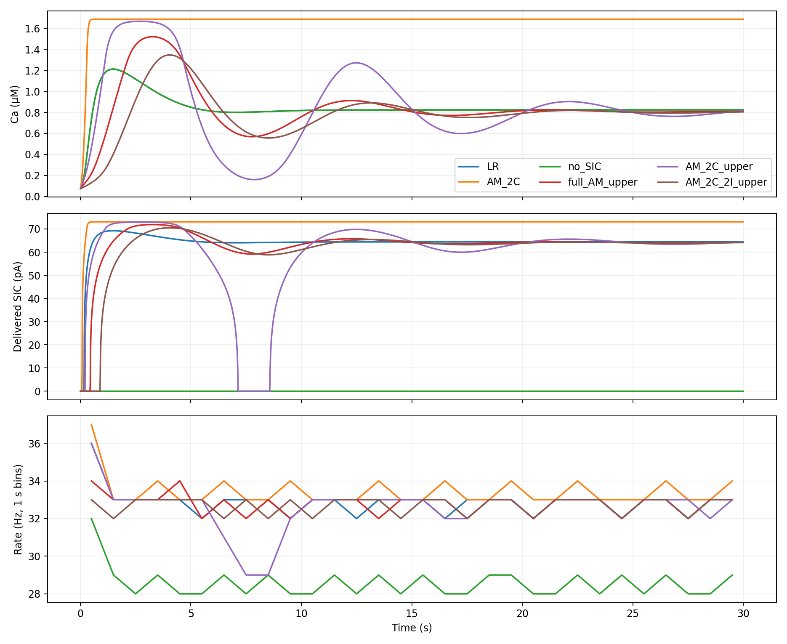
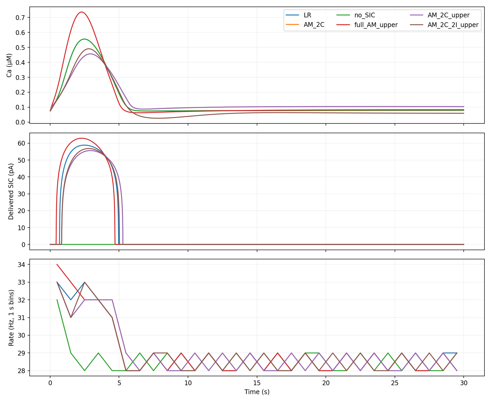

# Один дополнительный порог IP3: качество и время сети

Непрерывная поправка `w*(IP3-k)+` добавлена к трём AM-моделям. Перебирался k в [1.3, 1.9]; во всех случаях выбран k=1.3. Ниже порога исходное поле сохраняется точно. Старые модели и значения по умолчанию не изменены.

## Подбор и независимая сетевая проверка

Только два веса и положение порога подбирались по автономным равновесиям LR при IP3 = 2, 4, 8, 16, 32, 48 мкМ. Минимизировалась ошибка равновесий в латентных координатах. Сетевые траектории, спайки и времена не входили в подбор. Исходная матрица динамики в каждой C-области не менялась. Метод не оптимизирует переходные процессы и глобальная оптимальность модели не заявляется.

Сеть — официальный небольшой feedforward-пример NEST 3.10: 10 исходных и 10 целевых нейронов, 5 астроцитов. Проверены исходный скачок IP3=0.2 мкМ и стандартный 0.0002 мкМ. Оба опыта длятся 30 с при шаге 0.1 мс, один поток. Для моделей совпадают топология и пресинаптические спайки. Все модели стартуют из одного физического состояния. Переобучения после сетевой проверки не было.

| Модель | C в конце, мкМ | SIC в конце, пА | RMSE SIC, пА | Спайков | Сохранённый эффект SIC |
|---|---:|---:|---:|---:|---:|
| LR | 0.8246 | 64.424 | 0.000 | 9860 | 100.0% |
| full_AM | 1.6878 | 73.073 | 26.531 | 9810 | 96.1% |
| AM_2C | 1.6878 | 73.073 | 8.918 | 10030 | 113.2% |
| AM_2C_2I | 1.6878 | 73.073 | 32.997 | 9670 | 85.3% |
| no_SIC | 0.8246 | 0.000 | 64.524 | 8570 | 0.0% |
| full_AM_upper | 0.8065 | 64.132 | 6.240 | 9840 | 98.4% |
| AM_2C_upper | 0.7808 | 63.698 | 15.902 | 9770 | 93.0% |
| AM_2C_2I_upper | 0.7978 | 63.987 | 10.595 | 9810 | 96.1% |

Конечный уровень — среднее последних 5 с. Эффект SIC — число дополнительных спайков относительно no_SIC, делённое на соответствующую прибавку у LR. RMSE рассчитана по доставленному суммарному SIC всех целевых нейронов за весь опыт.

У полной AM RMSE SIC уменьшилась с 26.53 до 6.24 пА, у AM 2C+2I с 33.00 до 10.59 пА. У AM 2C ошибка, наоборот, выросла с 8.92 до 15.90 пА: лучшее плато не гарантирует лучшего переходного процесса. Все три исправленных варианта остаются в физических диапазонах C,h на записанных сетевых траекториях. Это наблюдение для данных запусков, не гарантия для любых входов.

При малом входе для каждой исходной/исправленной пары все сохранённые массивы траекторий и спайков совпадают побитово.





## Время симуляции

Тот же исходный вход, 30 с модельного времени. Все регистраторы отключены. Для каждой модели исключён один полный прогрев; затем семь повторов в перемешанном порядке. Измеряется nest.Run. Построение, Prepare и Cleanup записаны отдельно и не включены. RNG и топология фиксированы. Это время всей небольшой сети, а не изолированного астроцитарного решателя.

| Модель | Медиана, с | Минимум–максимум, с | Ускорение к LR |
|---|---:|---:|---:|
| LR | 3.428 | 3.265–3.552 | 1.00× |
| full_AM | 2.805 | 2.693–2.876 | 1.22× |
| AM_2C | 2.785 | 2.673–2.974 | 1.23× |
| AM_2C_2I | 2.733 | 2.639–2.869 | 1.25× |
| no_SIC | 3.259 | 3.201–3.541 | 1.05× |
| full_AM_upper | 2.769 | 2.634–2.823 | 1.24× |
| AM_2C_upper | 2.740 | 2.608–2.827 | 1.25× |
| AM_2C_2I_upper | 2.752 | 2.674–2.891 | 1.25× |

Сырые повторы и описательные bootstrap-интервалы ускорения сохранены в JSON. Они характеризуют разброс времени на этой машине, а не разброс поведения по сетям. Небольшие различия между вариантами нужно оценивать по диапазонам повторов.

## Сохранённые данные

- [evaluation.json](evaluation.json): параметры, метрики, временные повторы и хеши.
- [metrics.csv](metrics.csv): скалярные метрики по всем моделям и двум входам.
- [timings.csv](timings.csv): 56 измеренных запусков с раздельными стадиями.
- [fit.json](fit.json): обучающие равновесия, веса и выбранный порог.
- `traces/*.npz`: полные записанные траектории и спайки.
- Новые модели: `models/high_ip3_hinge/`.

Дополнительно сохраняются интеграл SIC, его максимумы и времена пиков, ошибки C/h, CV ISI, ошибка популяционной частоты в окнах 0.1 и 1 с, проверка физических границ и эффект относительно no_SIC. Один seed в полностью связанной feedforward-сети не доказывает сохранение синхронизации или других режимов рекуррентной сети Brunel.

## Воспроизведение

```bash
.venv/bin/python scripts/fit_high_ip3_hinge.py
# Собрать NEST-модуль по docs/nest_module.md
MPLCONFIGDIR=/tmp/matplotlib .venv/bin/python scripts/evaluate_high_ip3_hinge.py
MPLCONFIGDIR=/tmp/matplotlib .venv/bin/python scripts/report_high_ip3_hinge.py
```
