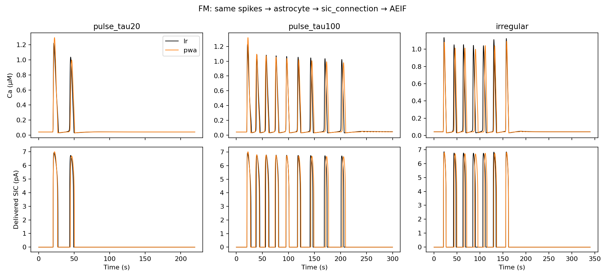
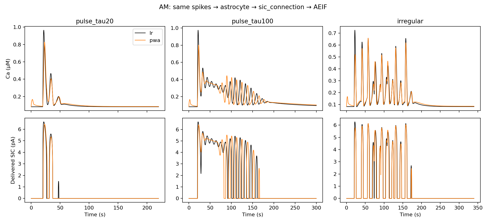

# AM/FM в NEST: SIC и скорость

Загружаемый C++-модуль `astrocyte_lr_pwa` сравнивается со штатным
`astrocyte_lr_1994`. Весь путь `spike_generator → астроцит → sic_connection →
aeif_cond_alpha_astro` работает внутри NEST 3.10.0.

## Скорость в NEST

Один поток, одинаковые входы, без мультиметров. Три повтора после прогрева;
ускорение = время LR / время PWA. Build и Prepare исключены из Run.
Популяции независимы, получают общий вход; это не рекуррентная сеть.

| Модель | Популяция | Только астроциты | Сеть с SIC и нейронами | Изолированный решатель |
|---|---:|---:|---:|---:|
| AM | 1 | 2.33× | 1.52× | 4.78× |
| AM | 64 | 7.26× | 2.11× | 5.55× |
| AM | 256 | 7.38× | 2.06× | 5.51× |
| FM | 1 | 2.43× | 1.47× | 3.86× |
| FM | 64 | 6.96× | 2.00× | 4.64× |
| FM | 256 | 7.17× | 2.04× | 4.68× |

Эта таблица: шаг 10 мс, 120 с модельного времени. Числа для одного
элемента занимают миллисекунды и сильнее зависят от накладных расходов.
Изолированный LR использует эквивалентные уравнения и GSL RKF45;
это диагностический замер, не время встроенной модели NEST.

### Стандартный шаг NEST и чувствительность скорости к разрешению

Популяция 64, 60 с, три повтора после прогрева; задержка соединений фиксирована 10 мс.

| Модель | Шаг, мс | Только астроциты | Сеть с SIC | Изолированный решатель |
|---|---:|---:|---:|---:|
| AM | 0.1 | 16.65× | 2.36× | 8.59× |
| AM | 1 | 14.20× | 2.37× | 7.72× |
| AM | 10 | 5.43× | 1.91× | 3.73× |
| FM | 0.1 | 21.82× | 2.36× | 10.86× |
| FM | 1 | 17.70× | 2.37× | 9.37× |
| FM | 10 | 5.06× | 1.85× | 3.01× |

Сырые времена всех повторов, включая отдельный Prepare:
[resolution_sweep.json](resolution_sweep.json).

## Одинаковые входы и выход SIC

Пять протоколов, общие физические начальные состояния из равновесия LR.
Коэффициенты заморожены; фазовое выравнивание не используется.
SIC_scale=1, SIC_th=.19669 μM; измеряется доставленный I_SIC нейрона.
У AM общий начальный покой не является собственным точным покоем PWA.

| Модель | Вход | Пики C LR/PWA | Пики SIC LR/PWA | RMSE C, μM | RMSE SIC, pA | Площадь SIC PWA/LR |
|---|---|---:|---:|---:|---:|---:|
| AM | pulse_tau20 | 3/4 | 3/2 | 0.04586 | 0.4241 | 0.964 |
| AM | pulse_tau100 | 14/13 | 13/11 | 0.08988 | 1.9376 | 0.940 |
| AM | pulse_tau180 | 17/21 | 18/18 | 0.05806 | 1.3691 | 0.899 |
| AM | periodic | 9/10 | 9/8 | 0.03209 | 0.5071 | 0.887 |
| AM | irregular | 14/14 | 14/14 | 0.03096 | 0.5364 | 0.906 |
| FM | pulse_tau20 | 2/2 | 2/2 | 0.06570 | 0.5655 | 1.005 |
| FM | pulse_tau100 | 9/9 | 9/9 | 0.18714 | 1.5762 | 1.032 |
| FM | pulse_tau180 | 17/17 | 17/17 | 0.29842 | 2.5242 | 1.040 |
| FM | periodic | 5/5 | 5/5 | 0.19030 | 1.4566 | 1.027 |
| FM | irregular | 7/7 | 7/7 | 0.21151 | 1.6781 | 1.056 |

Порог prominence для C — .02 μM, для SIC — .02 pA; это разные
счётчики. Подпороговый C-пик не обязан давать SIC. Счёт включает всю
траекторию, в том числе начальную релаксацию AM PWA до первого входа.

У FM число пиков совпадает на этих пяти протоколах, но ошибка фазы/формы
остаётся и на длинном спаде возрастает. У AM есть несовпадения числа пиков.
Ускорение решателя не устраняет ошибку модели. Эти проверки не являются
полной бифуркационной или независимой слепой приёмкой.

## Проверка реализации

| Модель | Реализация | max ошибка C против независимого DOP853, μM |
|---|---|---:|
| AM | lr | 1.68e-11 |
| AM | pwa | 1.47e-10 |
| FM | lr | 5.13e-10 |
| FM | pwa | 5.01e-09 |

Проверка DOP853: полный одиночный вход tau20, 220 с. Максимальная ошибка
доставки SIC против readout C с задержкой: 8.88e-16 pA.
Деление шага 10→5 мс на этом входе меняет C максимум на 4.99e-10 μM.
Терминальные состояния изолированных ядер сверены с NEST, включая sweep разрешений.
Полный набор тестов: 84 passed; также проверены split Simulate и два потока.

C-пересечения локализуются по аналитическому региональному потоку,
I-пересечения — через логарифм. Полные тиковые пропагаторы кешируются.
Планировщик NEST остаётся шаговым; глобальной гарантии первого выхода
за один тик нет. Наклонные C-пороги и CurrentEvent не поддержаны.

## Артефакты и воспроизведение

- [Методика, сборка и API](../../docs/nest_module.md).
- [Основные сырые результаты](benchmark.json).
- [Независимый аудит](independent_validation.json).
- [Хеши исходников, бинарных файлов и CPU](provenance.json).
- Полные траектории: `AM_*_{lr,pwa}.npz`, `FM_*_{lr,pwa}.npz`.
- Графики для экспорта: `AM_transfer.pdf`, `FM_transfer.pdf`.
