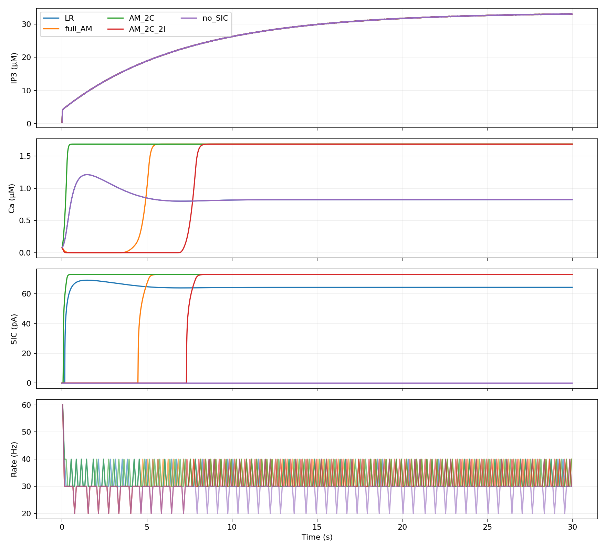

# Экстраполяция IP3 в исходной сети NEST

Проверка гипотезы: за последними порогами продолжить аффинное поле,
не менять вход и сравнить установившийся SIC и нейронную активность.
Переобучение не проводилось; IP3 не обрезался.

Тот же официальный `astrocyte_small_network.py`: 10 исходных нейронов,
10 целевых, 5 астроцитов. Скачок IP3 сохранён исходным: 0.2 мкМ.
Продолжительность увеличена до 30 с. Шаг 0.1 мс, один поток, один seed.
Топология и пресинаптические спайки совпадают во всех вариантах, что
проверено программно. Начальные состояния также одинаковы.

## Результат

| Модель | Выходных спайков за 30 с | Средняя частота, Гц/нейрон | Ca в последние 5 с, мкМ | SIC в последние 5 с, пА |
|---|---:|---:|---:|---:|
| LR | 9860 | 32.867 | 0.82449–0.82474 | 64.422–64.426 |
| Полная AM | 9810 | 32.700 | ≈1.68776 | ≈73.073 |
| AM 2C | 10030 | 33.433 | ≈1.68776 | ≈73.073 |
| AM 2C + 2I | 9670 | 32.233 | ≈1.68776 | ≈73.073 |
| Без SIC | 8570 | 28.567 | 0.82449–0.82474 | 0 |

IP3 за 30 с достигает 33.17 мкМ; значение около 8 мкМ в предыдущем
опыте относилось только к первой секунде. Под «SIC» здесь понимается
суммарный ток целевого нейрона от его соединений с астроцитами.

Гипотеза о почти постоянном выходе подтверждается на этом интервале.
Частоты отличаются от LR примерно на −0.5%, +1.7%, −1.9% соответственно.
При этом установившийся SIC выше примерно на 13.4%, а переходные процессы
различаются. Совпадение средней частоты не означает совпадения спайков.



## Что именно экстраполируется

Аффинно продолжается поле в преобразованных координатах u,v, а не
зависимость физического Ca от IP3. Обратная sqrt_tails-координата
асимптотически ограничивает Ca значением 2/1.185 ≈ 1.68776 мкМ.
Поэтому одинаковые уровни Ca у трёх вариантов отражают также насыщение
этой координаты; сами латентные состояния могут существенно различаться.

Дополнительно рассчитаны равновесия крайней области при фиксированном
конечном IP3 ≈33.03. Все три имеют отрицательные действительные части
собственных значений: линейная подсистема устойчива. Это анализ при
замороженном IP3, а не доказательство сходимости при продолжающихся спайках.

Однако полная AM и AM 2C+2I уже в записанной траектории дают h>1
(максимумы около 1.75 и 664). AM 2C на записанном интервале остаётся в
физических границах. Использовать эти модели как феноменологический
источник SIC можно оценивать по сетевым метрикам, но точность внутренней
биофизики вне области подбора этим опытом не подтверждена.

## Реализация и воспроизведение

В модуле появился явный параметр `allow_ip3_extrapolation=True`.
Он отключает только верхний предел IP3=1.3; по умолчанию прежняя проверка
сохранена. Старые модели и коэффициенты не менялись. Отрицательные и
нечисловые значения IP3 по-прежнему отвергаются.

```bash
MPLCONFIGDIR=/tmp/matplotlib .venv/bin/python scripts/build_nest_module.py --dev-include .cache/nest-source/dev/usr/include
MPLCONFIGDIR=/tmp/matplotlib .venv/bin/python scripts/validate_network_extrapolation.py
```

[Параметры, хеши моделей, ошибки и спектры](evaluation.json).
Полные записи в NPZ рядом. Времена включают запись и не являются бенчмарком.
Это один feedforward-пример; рекуррентная сеть Brunel пока не проверена.
