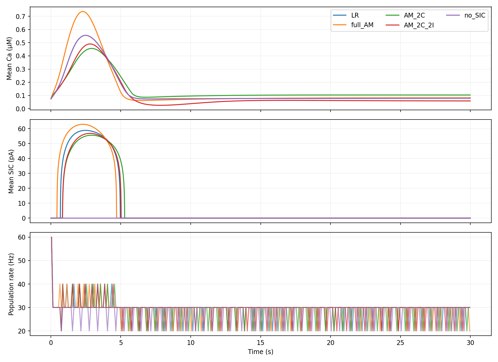

# Замена LR в небольшой сети NEST

Продолжение: [опыт с исходным входом и разрешённой экстраполяцией IP3](../network_extrapolation/REPORT.md).
Ниже сохранён первый опыт с действовавшей тогда проверкой диапазона.

Источник: официальный пример NEST 3.10 `astrocytes/astrocyte_small_network.py`. 10 исходных нейронов → 10 целевых, 5 астроцитов, TripartiteConnect, tsodyks_synapse и sic_connection.

## Исходный пример без изменения параметров

За 1 с IP3 в LR достигает 7.96 мкМ. Все три PWA-варианта останавливаются при выходе за обученный диапазон [0, 1.3]. Прямая замена в этом режиме не подтверждена. Ограничение не обходилось и вход не обрезался.

## Отдельный опыт в пределах диапазона

Скачок IP3 изменён с 0.2 на стандартный для модели NEST 0.0002 мкМ; длительность увеличена с 1 до 30 с. Остальные параметры исходного примера сохранены. У всех вариантов одинаковы начальное физическое состояние, топология и пресинаптические спайки (проверено программно). IP3 находится в диапазоне 0.196–0.402 мкМ.

| Модель | Спайки на выходе | Частота, Гц/нейрон | Прирост спайков относительно no SIC | RMSE SIC к LR, пА |
|---|---:|---:|---:|---:|
| LR | 8720 | 29.067 | +150 | 0.000 |
| full_AM | 8720 | 29.067 | +150 | 5.080 |
| AM_2C | 8710 | 29.033 | +140 | 4.575 |
| AM_2C_2I | 8710 | 29.033 | +140 | 2.983 |
| no_SIC | 8570 | 28.567 | +0 | 19.795 |

LR добавляет 150 спайков относительно отключённого SIC; полная AM сохраняет этот суммарный эффект, компактные варианты сохраняют 140/150 ≈ 93%. Это предварительное совпадение интегрального эффекта, не всех времён спайков.



## Что этот опыт не доказывает

Это одна детерминированная feedforward-сеть с синхронными популяциями, а не рекуррентная сеть. SIC здесь в основном переходный процесс первых примерно 5 с; стационарные осцилляции, синхронизация и сетевые переходы не проверены. Сходная средняя частота не означает совпадения временного профиля: формы Ca, SIC и времена спайков различаются. Контроль без SIC необходим, чтобы увидеть величину эффекта.

Следующий более сильный тест — официальный `astrocyte_brunel_fixed_indegree.py`: рекуррентная E/I-сеть с контролем без SIC, замороженными моделями, одинаковыми входами и топологией для каждой реализации. Следует проверить частоты, CV ISI, корреляции/синхронизацию, спектр популяционной активности и реакцию на стимул по нескольким реализациям. Перед заменой нужно подтвердить диапазон IP3 у исходного LR; если он шире 1.3 мкМ, потребуется отдельное расширение аппроксимации, а не тихое изменение сети.

Времена в JSON включают запись и единственный запуск; их нельзя использовать как измерение ускорения.

## Воспроизведение

```bash
MPLCONFIGDIR=/tmp/matplotlib .venv/bin/python scripts/validate_network_replacement.py
```

Параметры, контроль топологии, ошибки и SHA256 моделей: [evaluation.json](evaluation.json). Полные записи — в NPZ рядом.
