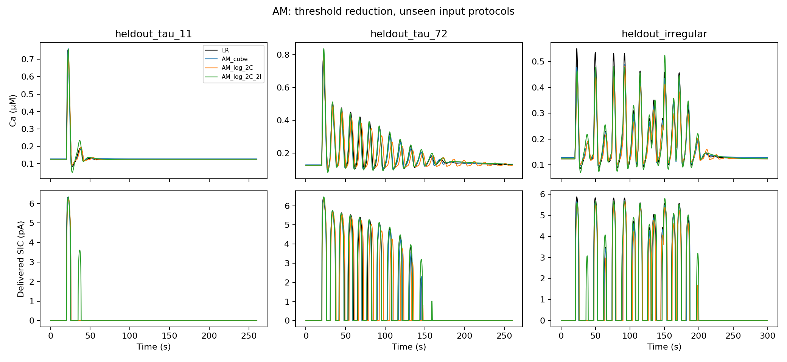
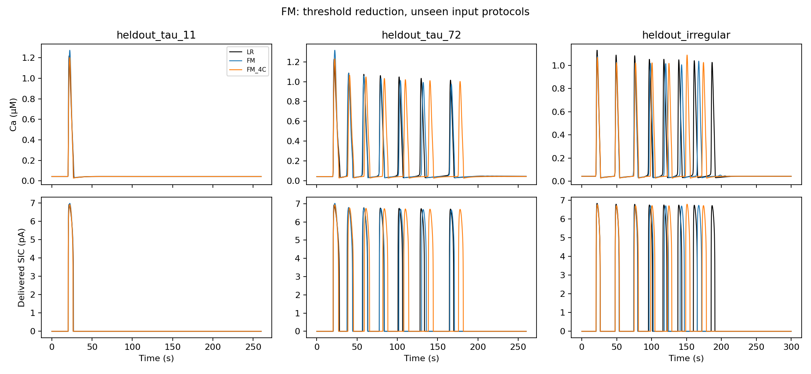

# Сокращение числа порогов AM/FM

Сравниваются две геометрии AM: два C-порога без I-порогов и те же
два C-порога с сохранёнными I-узлами .35,.64. Для FM — четыре C-порога.
Непрерывность поля, экспонента IP3 и физический readout сохранены.
Коэффициенты и упорядоченные C-пороги подбирались заново.
Старая последовательность спектральных типов не навязывалась;
константы двух строк выводятся из точного устойчивого покоя LR.
Это отдельный класс приближений, а не чистая абляция порогов.

## Выбор по обучению

Общий физический RestObjective: статические режимы, собственный покой,
пики, ширины, интервалы и слабая поточечная ошибка. Спектральные
якоря границ исключены и для полного контроля, и для сокращённой
модели. Эти числа нельзя сравнивать со старыми loss с другими остатками.
Выбор — только по полному независимому DOP853 replay обучения.
SIC-тесты и скорость не участвуют в выборе.

Перебраны все подмножества исходных порогов: по 6 стартовых проекций
на вариант AM и 70 на FM (включая два способа полевой инициализации).
Два лучших старта в каждом варианте уточнялись LS и локальным Powell,
по 1000 вызовов остатка на стадию. Ранние остановки сохранены.
Оптимальность этого локального поиска не утверждается.

| Модель | C/I-порогов | Областей | Параметров | Полный контроль: loss | Сокращённый: loss |
|---|---:|---:|---:|---:|---:|
| AM_cube_2C | 2/0 | 3 | 12 | 27.4367 | 326.0899 |
| AM_log_2C | 2/0 | 3 | 12 | 17.0751 | 289.5732 |
| AM_cube_2C_2I | 2/2 | 9 | 16 | 27.4367 | 42.3784 |
| AM_log_2C_2I | 2/2 | 9 | 16 | 17.0751 | 26.5146 |
| FM_4C | 4/0 | 5 | 18 | 24.1900 | 37.3684 |

Выбранные внутри каждой геометрии модели:

- AM_2C: AM_log_2C, [JSON](../../models/threshold_reduction/selected_AM_2C.json).
- AM_2C_2I: AM_log_2C_2I, [JSON](../../models/threshold_reduction/selected_AM_2C_2I.json).
- FM_4C: FM_4C, [JSON](../../models/threshold_reduction/selected_FM_4C.json).

## Что получилось

| Вариант | Средняя RMSE SIC: полный → компактный, pA | Время всей сети: полный → компактный, с |
|---|---:|---:|
| AM_2C | 0.6725 → 1.0204 | 1.3008 → 1.2635 |
| AM_2C_2I | 0.6725 → 0.6368 | 1.3008 → 1.2401 |
| FM_4C | 1.1909 → 1.9644 | 1.2759 → 1.2553 |

Сеть остаётся примерно в 2.3 раза быстрее LR в этой конфигурации.
Дополнительное снижение медианы времени после удаления порогов
составляет лишь несколько процентов и не выделяется убедительно
на фоне разброса трёх повторов. Для AM без I-порогов ускорение самих
астроцитов заметнее, но ошибка SIC выше. У AM с I-порогами средняя
ошибка ближе к полной модели, однако число SIC-пиков отличается
чаще. У FM сокращение до пяти областей повышает ошибку SIC.

Физические C-пороги выбранных моделей, μM:

- AM_2C: 0.12388181, 0.33921882.
- AM_2C_2I: 0.14946124, 0.33917937.
- FM_4C: 0.04306681, 0.04685088, 0.16902526, 0.38278519.

## Выход SIC в NEST

Пять новых входов на AM/FM, предварительно заданных в evaluation_plan.json.
Начало каждого кандидата — из собственного устойчивого покоя,
измеряется доставленный I_SIC целевого нейрона. Шаг 10 мс.
Все полные и сокращённые модели оцениваются на одинаковых спайках.

| Модель | Завершено | В физических диапазонах | Совпало число SIC-пиков | Средняя RMSE SIC, pA |
|---|---:|---:|---:|---:|
| AM_cube | 5/5 | 5/5 | 4/5 | 0.5976 |
| AM_log | 5/5 | 5/5 | 3/5 | 0.6725 |
| AM_cube_2C | 5/5 | 5/5 | 4/5 | 1.0386 |
| AM_log_2C | 5/5 | 5/5 | 4/5 | 1.0204 |
| AM_cube_2C_2I | 5/5 | 5/5 | 1/5 | 0.7795 |
| AM_log_2C_2I | 5/5 | 5/5 | 1/5 | 0.6368 |
| FM | 5/5 | 5/5 | 4/5 | 1.1909 |
| FM_4C | 5/5 | 5/5 | 3/5 | 1.9644 |

## Скорость

Один поток, 64 пары, шаг 1 мс, 60 с модельного времени. Три повтора
после исключённого прогрева; запись траекторий отключена. Build,
Prepare и чтение данных не входят в Run. Изолированные ядра измерены
отдельно, три повтора без отдельного прогрева. Эти результаты
не смешиваются с прежним benchmark .1 мс.

| Модель | Астроциты: с | Сеть с SIC: с | Ускорение сети против LR | Изолированное ядро: с |
|---|---:|---:|---:|---:|
| AM/LR | 1.7181 | 2.9451 | 1× | — |
| AM/AM_cube | 0.1322 | 1.2949 | 2.27× | 0.1005 |
| AM/AM_log | 0.1254 | 1.3008 | 2.26× | 0.0973 |
| AM/AM_log_2C | 0.0978 | 1.2635 | 2.33× | 0.0735 |
| AM/AM_log_2C_2I | 0.1245 | 1.2401 | 2.37× | 0.0927 |
| FM/LR | 1.7247 | 2.8622 | 1× | — |
| FM/FM | 0.0964 | 1.2759 | 2.24× | 0.0844 |
| FM/FM_4C | 0.0920 | 1.2553 | 2.28× | 0.0834 |

## Проверка реализации

Сокращённые модели отдельно сверены с собственным DOP853 на первом новом входе:

| Модель | max ошибка C, μM | max ошибка h |
|---|---:|---:|
| AM_cube_2C | 1.5e-09 | 1.41e-10 |
| AM_log_2C | 4.52e-11 | 8.48e-12 |
| AM_cube_2C_2I | 7.03e-12 | 1.02e-12 |
| AM_log_2C_2I | 5.52e-11 | 1.05e-11 |
| FM_4C | 8.7e-11 | 5.43e-12 |

Ускорение и компактность не означают равноточность LR или сохранение
бифуркаций. Время поиска C-пересечения основано на bracketing внутри
тика; глобальной сертификации первого выхода нет. Полная приёмка
моделей не заявляется. Исходные модели не перезаписаны.

[Формулировки для статьи и границы вывода](../../docs/article_claims.md).
Сырые метрики, времена и все неудачи: evaluation.json и каталоги поиска.
NEST-траектории — nest/*.npz; графики для экспорта — AM_transfer.pdf и FM_transfer.pdf.
